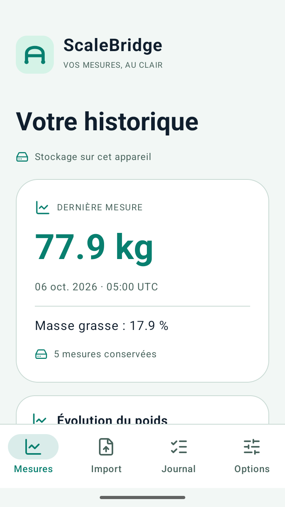
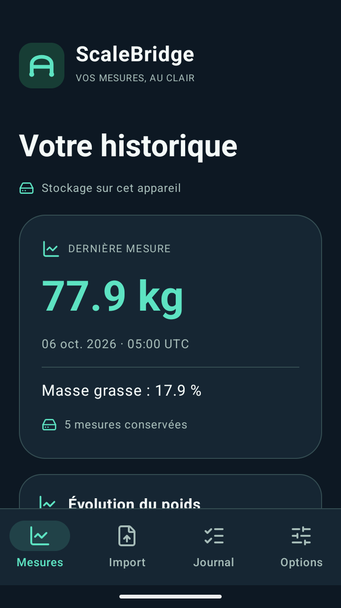

# ScaleBridge web

**Vos mesures, au clair. / Your data, in order.**

[Démo publique / Live demo](https://scalebridge.altorru.fr/demo.html) · [Site](https://scalebridge.altorru.fr/) · [Identité / Brand](https://scalebridge.altorru.fr/brand.html)

## Français

Édition web gratuite et autonome de ScaleBridge : vitrine, démo CSV fixe, téléchargements fictifs et assets graphiques. HTML, CSS et JavaScript natifs ; aucun package JavaScript, backend, compte, formulaire d’upload ou analytics requis.

La démo montre six lignes fictives : trois mesures conservées, un doublon, un conflit et une ligne refusée. Elle affiche des résultats précalculés, **ne traite pas vos fichiers** et ne contient pas le moteur Android. Les fichiers CSV/JSON et le guide sont téléchargeables sans JavaScript. Le retour email est volontaire : vous relisez le message et choisissez de l’envoyer, sans fichier réel ni mesure de santé.

### Démarrer

Python 3.9+ sert uniquement à tester/servir les fichiers statiques. Aucun pip/npm ni build nécessaire.

```sh
git clone https://github.com/Altorru/scalebridge-web.git
cd scalebridge-web
python3 tools/check.py
python3 -m http.server 8080 --bind 127.0.0.1
```

Ouvrir http://127.0.0.1:8080/ puis `demo.html`. Si 8080 est occupé, choisir un autre port sans arrêter le service existant. Choisir Clair/Sombre/Système, parcourir les trois étapes et télécharger les résultats. `python3 tools/package_downloads.py` régénère les deux ZIP publics, uniquement à partir de ces sources. Pour la production, servir uniquement les fichiers listés dans `PUBLIC_MANIFEST.json` et ce manifeste ; exclure `.git`, fichiers locaux et métadonnées du dépôt. Aucun réglage serveur privé n’est fourni. Pour votre propre publication, adapter URLs canoniques, sitemap, identité et contact. Les logs/rétentions de votre hébergeur ne sont pas définis par ce code.

### Limites

Aucune source Android, APK/AAB/JAR, signature, synchronisation de balance, connecteur fabricant, paiement ou données utilisateur dans ce dépôt. Les captures montrent un candidat Android à données fictives et servent d’illustration ; elles ne prouvent ni publication Play ni usage réel. Le pilote évoqué par la vitrine est volontaire et séparé de ce dépôt. Aucune validation médicale, compatibilité fournisseur ou résultat de pilote n’est revendiqué. L’export vers un logiciel tiers doit être vérifié séparément.

## English

Free, standalone ScaleBridge web edition: static website, fixed fictional CSV demo, downloadable sample results and brand assets. Plain HTML/CSS/JavaScript; no JavaScript package, backend, account, upload form or analytics dependency.

The demo displays six fictional rows and precomputed results: three saved measurements, one duplicate, one conflict and one rejected row. **It does not process your files.** The Android importer is not included. Downloads work without JavaScript. Optional email feedback is composed locally for your review; nothing is sent automatically.

Use the commands above with Python 3.9+, open http://127.0.0.1:8080/, check the three steps and downloads, and switch themes. Deploy only files listed in `PUBLIC_MANIFEST.json` plus that manifest, excluding `.git` and local files; adapt canonical URLs, sitemap, publisher details and contact. Your hosting logs and retention are separate from the code.

No Android code/binaries/signatures, provider connectors, payment, real health data or participant records are included. Screenshots use fictional values; they do not prove Play publication or real users. No medical or provider compatibility claims are made.

## Licence / License

Original web code, documentation, fictional fixtures and original ScaleBridge artwork: [MIT](LICENSE), authorized by the owner. Lucide 1.52.0 retains its [ISC and Feather-derived MIT notices](licenses/Lucide-ISC.txt). Attribution and vendored SVGs remain intact. See [THIRD_PARTY.md](THIRD_PARTY.md). No font files are bundled; SVG logos reference system sans/Arial. Names in screenshots are product UI labels, not participant identities.

[Contributing](CONTRIBUTING.md) · [Security](SECURITY.md) · Support: contact@hugoviaud.fr



